  

  

 

**Independent builder and creator crafting games, AI agents, custom models, and web worlds by day—and sharing builds, devlogs, and reactions by night.**

 

  
  
  
  
  

 

<a href="#about-me"><b>About</b></a>
  ·  <a href="#toolbox"><b>Toolbox</b></a>
  ·  <a href="#ecosystems--builds"><b>Ecosystems</b></a>
  ·  <a href="#projects--workspaces"><b>Projects</b></a>
  ·  <a href="#youtube-channels"><b>YouTube</b></a>
  ·  <a href="#highlights"><b>Highlights</b></a>

---

## About Me

- **Architect & Creator:** Building autonomous AI agents, custom model pipelines, game engines, and full-stack web platforms on my own terms.
- **Stack Range:** Low-level systems (`C`, `C++`, `Rust`) to high-level AI and web (`Python`, `JavaScript`) across GitHub and GitLab.
- **Workspaces:** [Main Portfolio](https://sushantkhatri.pages.dev/) · [Builder Lab](https://sushantkhatridev.pages.dev/) · [GitLab Group](https://gitlab.com/groups/sushantkhatridev)
- **Ask Me About:** Game dev, AI agent orchestration, custom models, and creator setups.

<b>More about my philosophy & vision</b>

 

> *"Those who can imagine anything, can create the impossible."* — **Alan Turing**

> *"Never let anyone control you or dictate what you want—walk away and move on knowing your worth, never hurt those who stood by you at your lowest, and never backstab anyone, for I would rather die in loyalty than betray; this war was never about gain, it was born of your tyranny, treachery, and rule violations."* — **Sushant Khatri**

> *"Own your path and walk away from control knowing your worth; never hurt those who stood by you at your lowest, and never backstab anyone—I would rather die in loyalty than betray, for the first war was never about gain, it was against your tyranny, treachery, and broken rules."* — **Sushant Khatri**

Combining low-level systems engineering with modern AI and game design, I turn raw concepts into playable worlds, autonomous agents, and web experiences while building in public with the community.

---

## Toolbox

  
    
  
    
  
    
  
    
  
    
  
    
  
    
  
    
  

`C` · `C++` · `Rust` · `Python` · `JavaScript` · `Linux` · `HTML/CSS` · `Git`

---

## Ecosystems & Builds

<table>
<tr>
<td width="33%" align="center" valign="top">

### Runexel
**AI & Software Hub**

Autonomous AI agents, custom model pipelines, and developer tools.

`Python` · `AI` · `Systems`

[Explore Hub →](https://github.com/Runexel)

</td>
<td width="33%" align="center" valign="top">

### Sutomiuxe
**Game Creation Hub**

Playable interactive worlds, custom mechanics, and open-source assets.

`C++` · `Rust` · `GameDev`

[Explore Hub →](https://github.com/Sutomiuxe)

</td>
<td width="33%" align="center" valign="top">

### NexusFrag
**Collaborative Team Hub**

Full-stack web platforms, team builds, and community releases.

`JavaScript` · `Web` · `OSS`

[Explore Hub →](https://github.com/NexusFrag)

</td>
</tr>
</table>

---

## Projects & Workspaces

| Project / Hub | Focus | Stack | Link |
| :--- | :--- | :--- | :--- |
| **Runexel** | Autonomous AI agents, custom model pipelines, and software tools | `Python` · `AI` · `Systems` | [github.com/Runexel](https://github.com/Runexel) |
| **Sutomiuxe** | Custom games, interactive worlds, and game engine experiments | `C++` · `Rust` · `GameDev` | [github.com/Sutomiuxe](https://github.com/Sutomiuxe) |
| **NexusFrag** | Collaborative team builds and open-source web releases | `JavaScript` · `Web` · `OSS` | [github.com/NexusFrag](https://github.com/NexusFrag) |
| **Main Portfolio** | Personal showcase, active builds, and creator overview | `HTML/CSS` · `JavaScript` | [sushantkhatri.pages.dev](https://sushantkhatri.pages.dev/) |
| **Builder Lab** | Interactive web sandbox, prototypes, and builder workspace | `Web` · `Full-Stack` | [sushantkhatridev.pages.dev](https://sushantkhatridev.pages.dev/) |
| **GitLab Mirror & Repos** | Multi-platform repositories and private/public engineering work | `C` · `C++` · `Git` | [gitlab.com/sushantkhatridev](https://gitlab.com/groups/sushantkhatridev) |
| **Dev Blog** | Technical notes, build logs, and developer thoughts | `Writing` · `DevLogs` | [sushantkhatridev.blogspot.com](https://sushantkhatridev.blogspot.com/) |

---

## YouTube Channels

<table>
<tr>
<td width="33%" align="center" valign="top">

### Sutolix
Live reactions, showcases, thoughts, and community vibes.

[Watch Channel →](https://youtube.com/@sutolix)

</td>
<td width="33%" align="center" valign="top">

### Runexel
AI agents, software builds, devlogs, and code breakdowns.

[Watch Channel →](https://youtube.com/@runexel)

</td>
<td width="33%" align="center" valign="top">

### Sutomiuxe
Game development, playable demos, and creative worlds.

[Watch Channel →](https://youtube.com/@sutomiuxe)

</td>
</tr>
</table>

---

## Highlights

  
  
  
  <!-- STAR_BADGE_START -->
  
  <!-- STAR_BADGE_END -->
  
  

 

  

  

<b>My vision. My rules.</b> · Loyalty over backstabbing · Built in public across games, AI, and web.
 
Solely created & owned by <b>Sushant Khatri</b> (<b>SushantKhatriDev</b> / <b>Runexel</b>) · Code: <a href="LICENSE">GPL-3.0</a> · Art, SVGs, Media & Quotes: <a href="LICENSE-CC-BY-SA-4.0.txt">CC BY-SA 4.0</a> (credit Sushant Khatri & note all changes).

