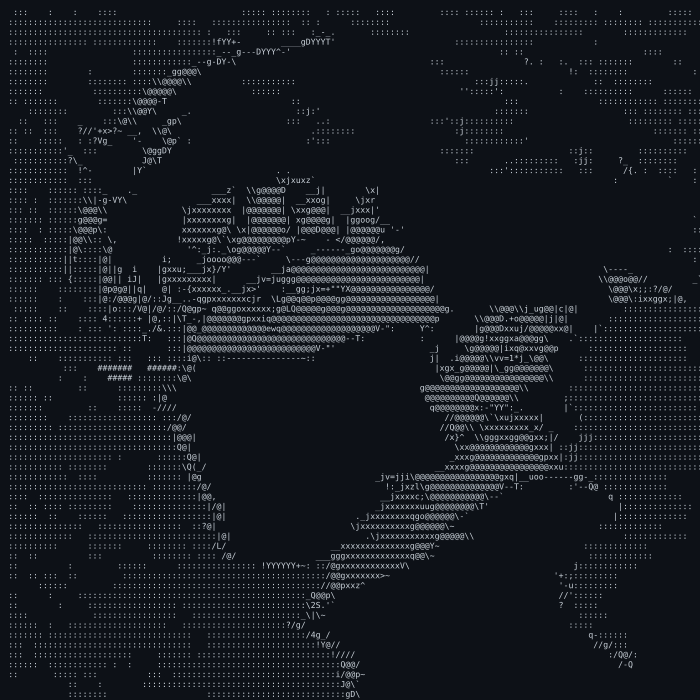

  

 

**Independent builder and creator crafting games, AI agents, models, software, and web experiences by day—and sharing builds, reactions, and ideas with the community by night! 🛠️ 🧠**

 

> *"Those who can imagine anything, can create the impossible."* — **Alan Turing**

 

<!-- 🚀 Social Badges right under intro for quick access -->

  
  
  
  

 

<!-- 🚀 Jump navigation right after header elements -->
<a href="#-about-me"><b>About</b></a>
  ·    <a href="#-toolbox"><b>Toolbox</b></a>
  ·    <a href="#-github-organizations"><b>Organizations</b></a>
  ·    <a href="#-youtube-channels"><b>YouTube</b></a>
  ·    <a href="#-github-activity"><b>Activity</b></a>

 

---

## 🚀 About Me

- 🛠️ Independent **builder & creator**—I don't just play games or use tools, **I architect games, AI agents, custom models, software, and web platforms** on my own terms
- 🔭 Currently shipping **autonomous AI agents, playable game systems, full-stack web apps, and my creator ecosystem**
- ⚡ **Builder Facts:** Multi-org founder (**Runexel**, **Sutomiuxe**, **NexusFrag**) · Low-level systems (`C`, `C++`, `Rust`) to high-level AI & Web (`Python`, `JS`) · Shipping in public across GitHub & GitLab
- 🧠 Core focus: **AI agent orchestration, custom model pipelines, game engines & mechanics, and modern web architecture**
- 🎥 I love sharing live builds, reactions, thoughts, and interactive worlds with everyone!
- 👨‍💻 Main Portfolio: [sushantkhatri.pages.dev](https://sushantkhatri.pages.dev/)
- 🛠️ Builder Workspace: [sushantkhatridev.pages.dev](https://sushantkhatridev.pages.dev/)
- 🏢 GitLab Group: [gitlab.com/sushantkhatridev](https://gitlab.com/groups/sushantkhatridev)
- 💬 Ask me about **Game development, AI agents & models, web builds, and content creation**
- 📫 How to reach me **Through LinkedIn, my YouTube channels, GitLab, or blogs**

<b>▸ More about my background & vision</b>

 

> *"First, solve the problem. Then, write the code."* — **John Johnson**

I build what I envision—managing my own path as a creator rather than fitting into a traditional box. Combining low-level systems engineering with modern AI and game design, I turn raw concepts into playable worlds, autonomous AI agents, custom models, and web experiences while bringing the community along for the ride.

 

---

## ◇ Toolbox

  
    
    
  
    
    
    
    
    
    

 

`C` · `C++` · `Python` · `JavaScript` · `Rust` · `Linux` · `HTML/CSS` · `Git`

 

---

## 🏢 GitHub Organizations

<table>
<tr>
<td width="33%" align="center" valign="top">

### 💻 Runexel
Builder Hub: AI agents, models, software, and web projects.

[Explore Hub 🛠️](https://github.com/Runexel)

</td>

<td width="33%" align="center" valign="top">

### 💎 Sutomiuxe
Game Creation Hub: Custom games, engines, and open-source assets.

[Explore Hub ✨](https://github.com/Sutomiuxe)

</td>

<td width="33%" align="center" valign="top">

### ⚔️ NexusFrag
Team Hub: Collaborative builds and community releases.

[Explore Hub 🚀](https://github.com/NexusFrag)

</td>
</tr>
</table>

 

---

## 🎥 YouTube Channels

<table>
<tr>
<td width="33%" align="center" valign="top">

### ⚔️ Sutolix
Creator & Reactions: Live reactions, sharing thoughts, showcases, and community vibes.

[Subscribe 🚀](https://youtube.com/@sutolix?si=t5r3jrqmZqvhek4U)

</td>

<td width="33%" align="center" valign="top">

### 💻 Runexel
Builder Channel: AI agents, software builds, devlogs, and code breakdowns.

[Subscribe 🛠️](https://youtube.com/@runexel?si=ybnuEoviSb0ssg_1)

</td>

<td width="33%" align="center" valign="top">

### 💎 Sutomiuxe
Game Dev & Worlds: Building games, interactive demos, and creative entertainment.

[Subscribe ✨](https://youtube.com/@sutomiuxe?si=UKfD-_K3X9jocRt-)

</td>
</tr>
</table>

 

---

## ◇ GitHub Activity

### Building in public.

Games, AI agents, models, web apps, and constant iteration.

 
 

<picture>
  <source
    media="(prefers-color-scheme: dark)"
    srcset="https://github-profile-summary-cards.vercel.app/api/cards/profile-details?username=SushantKhatriDev&theme=github_dark"
  />
  <source
    media="(prefers-color-scheme: light)"
    srcset="https://github-profile-summary-cards.vercel.app/api/cards/profile-details?username=SushantKhatriDev&theme=github"
  />
  
</picture>

 
 

<table>
<tr>
<td width="50%" align="center">

<picture>
  <source
    media="(prefers-color-scheme: dark)"
    srcset="https://github-profile-summary-cards.vercel.app/api/cards/stats?username=SushantKhatriDev&theme=github_dark"
  />
  <source
    media="(prefers-color-scheme: light)"
    srcset="https://github-profile-summary-cards.vercel.app/api/cards/stats?username=SushantKhatriDev&theme=github"
  />
  
</picture>

</td>

<td width="50%" align="center">

<picture>
  <source
    media="(prefers-color-scheme: dark)"
    srcset="https://github-profile-summary-cards.vercel.app/api/cards/productive-time?username=SushantKhatriDev&theme=github_dark&utcOffset=5.75"
  />
  <source
    media="(prefers-color-scheme: light)"
    srcset="https://github-profile-summary-cards.vercel.app/api/cards/productive-time?username=SushantKhatriDev&theme=github&utcOffset=5.75"
  />
  
</picture>

</td>
</tr>
</table>

 

 

 

---

<!-- 🏆 Earned GitHub Achievements -->
<h3>🏆 GitHub Achievements</h3>

  
  
  
  <!-- STAR_BADGE_START -->
  
  <!-- STAR_BADGE_END -->

 

<!-- ✨ Bottom typing SVG linked to LinkedIn -->

 

**Builder · Game & AI Maker · Web & Digital Creator**

 

 
 

If something here inspires you, explore a project, connect on LinkedIn, or check out my channels!

