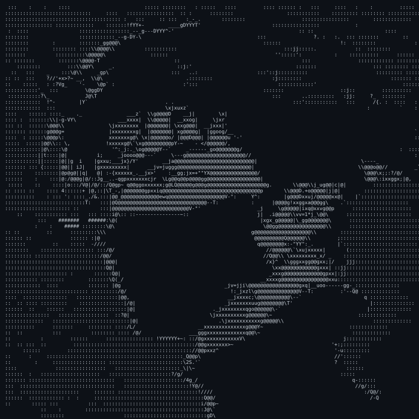

  

  

<h3 align="center">A passionate software developer crushing CS50x & CodeInPlace by day, and gaming, reacting, and having fun with everyone by night! 🧠 🎮</h3>

  
  
  
  

 

<a href="#-about-me"><b>About</b></a>
  ·    <a href="#-languages-and-tools"><b>Toolbox</b></a>
  ·    <a href="#-connect-with-my-github-organizations"><b>Organizations</b></a>
  ·    <a href="#-connect-with-me-on-youtube"><b>YouTube</b></a>

 

---

### 🚀 About Me

- 🔭 I’m currently working on **CS50x, CodeInPlace, and building my digital creator brand**
- 🌱 I’m currently learning **C, Python, and advanced computer science logic**
- 🎮 I love playing games, dropping live reactions, sharing thoughts, and having a blast with everyone!
- 👨‍💻 Main Portfolio: [sushantkhatri.pages.dev](https://sushantkhatri.pages.dev/)
- 🛠️ Developer Workspace: [sushantkhatridev.pages.dev](https://sushantkhatridev.pages.dev/)
- 👔 LinkedIn Profile: [linkedin.com/in/sushantkhatridev](https://linkedin.com/in/sushantkhatridev)
- 🦊 GitLab Profile: [gitlab.com/SushantKhatri](https://gitlab.com/SushantKhatri)
- 🏢 GitLab Dev Group: [gitlab.com/sushantkhatridev](https://gitlab.com/groups/sushantkhatridev)
- 📝 Tech & Dev Blog: [sushantkhatridev.blogspot.com](https://sushantkhatridev.blogspot.com/)
- 💬 Ask me about **Coding, game design, and content creation**
- 📫 How to reach me **Through LinkedIn, my YouTube channels, GitLab, or blogs**

---

### 🛠️ Languages and Tools:

  
    
    
  
    
    
    
    
    
    

---

### 🏢 Connect with my GitHub Organizations:

| Org Icon | Organization Name | Content & Purpose Focus | Link |
| :---: | :--- | :--- | :---: |
| 💻 | **Runexel** | Coding Channel: Scripts, devlogs, and tutorial projects | [Explore Hub 🛠️](https://github.com/Runexel) |
| 💎 | **Sutomiuxe** | Gaming Assets: Community open-source code and files | [Explore Hub ✨](https://github.com/Sutomiuxe) |
| ⚔️ | **NexusFrag** | Team Hub: Collaborative projects and community updates | [Explore Hub 🚀](https://github.com/NexusFrag) |

---

### 🎥 Connect with me on YouTube:

| Channel Icon | Channel Name | Content Focus | Link |
| :---: | :--- | :--- | :---: |
| ⚔️ | **Sutolix** | Gaming & Reactions: Fun gameplay, live reactions, talking thoughts, and community vibes | [Subscribe 🚀](https://youtube.com/@sutolix?si=t5r3jrqmZqvhek4U) |
| 💻 | **Runexel** | Coding Channel: Code tutorials, devlogs, and scripts | [Subscribe 🛠️](https://youtube.com/@runexel?si=ybnuEoviSb0ssg_1) |
| 💎 | **Sutomiuxe** | Gaming Channel: Gaming and entertainment content | [Subscribe ✨](https://youtube.com/@sutomiuxe?si=UKfD-_K3X9jocRt-) |

---

  

